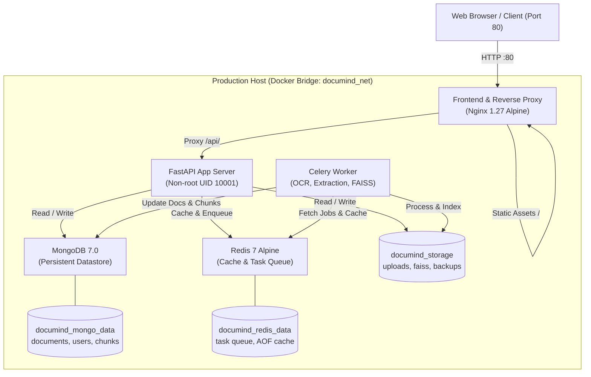

# DocuMind AI — Production Deployment & Acceptance Guide

This guide outlines the production deployment architecture, security configuration, persistent storage model, and end-to-end verification procedures for **DocuMind AI**.

---

## 1. Deployment Architecture & Environment Decision (Step 15.1)

DocuMind AI uses a **Docker Compose v2** single-node multi-container orchestration architecture.

### Why Docker Compose?
* **Deterministic Reproducibility:** Packages all five services (React SPA + Nginx, FastAPI, Celery worker, MongoDB 7.0, and Redis 7.0) with exact dependencies, volume mounts, and network isolation.
* **Single-Origin Simplicity:** Nginx acts as the unified reverse proxy, serving the compiled React frontend assets while proxying `/api` traffic internally to the FastAPI backend. This completely eliminates CORS issues in production and ensures datastores remain unexposed to the host or internet.
* **Cost & Operational Efficiency:** Avoids the maintenance overhead and cloud lock-in of Kubernetes or multi-cluster infrastructure while guaranteeing high reliability, healthcheck auto-restart, and strict resource boundaries.

### Production Topology Diagram



---

## 2. Production Configuration & Security (Step 15.2)

### 2.1 Service Specifications

| Service | Image / Base | Internal Port | External Port | Memory Limit | CPU Limit | Health Check |
| :--- | :--- | :--- | :--- | :--- | :--- | :--- |
| **frontend** | `nginx:1.27-alpine` | `80` | `80` (or `${PORT}`) | 256 MB | 1.0 CPU | `curl -f http://127.0.0.1/healthz` |
| **backend** | `python:3.12-slim` | `8000` | *None (internal only)* | 1536 MB | 2.0 CPU | `curl -f http://127.0.0.1:8000/health/ready` |
| **celery_worker** | `python:3.12-slim` | *None* | *None* | 1536 MB | 2.0 CPU | Task heartbeat via Redis |
| **mongodb** | `mongo:7.0` | `27017` | *None (internal only)* | 1024 MB | 1.5 CPU | `mongosh --eval "db.adminCommand('ping')"` |
| **redis** | `redis:7-alpine` | `6379` | *None (internal only)* | 384 MB | 1.0 CPU | `redis-cli ping` |

### 2.2 Security Hardening
* **Non-Root Execution:** The backend and worker run as unprivileged user `documind` (UID `10001`, GID `10001`).
* **Kernel Security Flags:** All services run with `security_opt: [no-new-privileges:true]`. Redis drops all Linux capabilities (`cap_drop: [ALL]`).
* **Network Isolation:** Only the frontend container binds to the host interface. MongoDB and Redis communicate exclusively over the internal Docker network `documind_net`.
* **Zero Secrets in Git:** Sensitive environment variables (`JWT_SECRET_KEY`, `GEMINI_API_KEY`) are managed via `.env` files that are strictly `.gitignore`d. Docker build contexts use `.dockerignore` to prevent local virtualenvs or credential files from entering image layers.

### 2.3 Persistent Volumes

Three persistent Docker named volumes maintain state across container restarts and image updates:
1. `documind_storage`: Uploaded receipt files (`storage/uploads`), FAISS vector index files (`storage/faiss`), and index snapshots.
2. `documind_mongo_data`: MongoDB primary data files for user accounts, document metadata, OCR extracts, and chunk mappings.
3. `documind_redis_data`: Append-only file (`appendonly yes`) persistence for active task queue and semantic cache state.

### 2.4 Networking, Reverse Proxy & HTTPS Architecture (Step 15.3)

* **Dual-Port Exposure:** The frontend Nginx container binds to both HTTP (`80`) and HTTPS (`443`) on the host. All public HTTP requests are automatically redirected via HTTP 301 to secure HTTPS (`return 301 https://$host$request_uri;`).
* **Automated & Custom SSL Certificates:**
  * **Automated Fallback:** When `./ssl/cert.pem` and `./ssl/key.pem` are not mounted, the Nginx container entrypoint generates a 2048-bit RSA self-signed certificate, enabling immediate out-of-the-box HTTPS testing (`https://localhost`).
  * **Production Certificates:** Mount your custom CA or Let's Encrypt certificates by placing `cert.pem` (full chain) and `key.pem` (private key) in the root `./ssl/` folder.
* **Modern Cryptographic Standards:** Configured with `TLSv1.2` and `TLSv1.3`, modern high-strength cipher suites, SSL session caching (`shared:SSL:10m`), and HTTP Strict Transport Security (`Strict-Transport-Security: max-age=31536000; includeSubDomains`).
* **Reverse Proxy Upload Limits & Timeouts:**
  * `client_max_body_size 15M;`: Comfortably accommodates maximum receipt and document uploads (10MB limit plus multipart form boundary overhead).
  * `proxy_connect_timeout 60s; proxy_read_timeout 120s; proxy_send_timeout 120s;`: Prevents gateway timeouts during compute-intensive Gemini OCR and FAISS semantic chunking.
* **Private Datastore Isolation:** MongoDB (`27017`), Redis (`6379`), and FastAPI backend (`8000`) define **no host ports**. They reside exclusively on the private Docker bridge network `documind_net`.
* **CORS & Public Origin Control:** When accessed via the unified reverse proxy, the frontend and API share the exact same origin (`https://<domain>/` and `https://<domain>/api/`), preventing third-party cross-origin exploitation. Direct API access validates against explicit `CORS_ORIGINS` whitelists and rejects wildcards in production.
* **Authentication Security:** Implements stateless JWT Bearer tokens passed via the standard `Authorization: Bearer <token>` HTTP header. Interactive documentation (`/docs`, `/redoc`, `/openapi.json`) is disabled in production to prevent schema leakage.

### 2.5 Background Processing & Celery Architecture (Step 15.4)

* **Celery Worker Execution:** Started with `celery -A app.celery_app worker --loglevel=INFO --concurrency=2`.
* **Broker Connectivity & Auto-Reconnect:**
  * `broker_connection_retry_on_startup=True` ensures the worker waits gracefully for Redis readiness during cold boots.
  * Exponential reconnection backoff (`interval_start=1.0`, `interval_step=1.0`, `interval_max=10.0`) guarantees stability during network partitions.
* **Redis Eviction Safety (`volatile-lru`):**
  * **Critical Architecture Decision:** Redis is configured with `--maxmemory-policy volatile-lru` instead of `allkeys-lru`.
  * **Why?** DocuMind AI uses Redis for two distinct purposes: (1) ephemeral semantic query caching (which includes an explicit TTL: `REDIS_CACHE_TTL_SECONDS`), and (2) Celery task queues / broker state (which do *not* have an expiration TTL).
  * Under `volatile-lru`, only keys with an explicit TTL can be evicted under memory pressure. Celery queue keys are permanently protected from eviction, preventing dropped document tasks or silent job losses.
* **Worker Concurrency & Timeouts:**
  * `worker_prefetch_multiplier=1`: Ensures each worker concurrency slot claims only one document task at a time, eliminating head-of-line blocking for long-running multi-page documents.
  * `task_soft_time_limit=180`: Allows Celery tasks up to 3 minutes to gracefully catch timeouts before termination.
  * `task_time_limit=240`: Hard kills runaway processes after 4 minutes.
  * `task_acks_late=True` and `task_reject_on_worker_lost=True`: Tasks are acknowledged only upon completion; if a worker container crashes during processing, the uncompleted task is safely requeued.
* **Document Status Consistency:**
  * Asynchronous processing updates MongoDB atomically across distinct lifecycle stages: `PENDING` -> `PROCESSING` (`ocr_processing`) -> `OCR_COMPLETED` -> `EXTRACTION_COMPLETED` -> `COMPLETED`.
  * On unrecoverable errors, the document record is updated to `status: FAILED` with detailed `processing.stage` and `processing.error` information for client inspection via `/api/v1/documents`.

### 2.6 Persistence & Disaster Recovery Model (Step 15.5)

* **Zero Container-Local State Reliance:** No application state is written to container-local layers. All critical assets reside on persistent external Docker named volumes:
  1. `documind_storage`: Uploaded receipt files (`storage/uploads`), FAISS vector index files (`storage/faiss`), and backup bundles (`storage/backups`).
  2. `documind_mongo_data`: Primary MongoDB data files (`/data/db`), preserving user records, document metadata, OCR extracts, and chunk embeddings.
  3. `documind_redis_data`: Append-Only File (`appendonly yes`) persistence preserving active task broker queues and result keys.
* **Container Recreation Resilience:**
  * Stopping or removing containers (`docker compose down` or `docker compose up --force-recreate`) does **not** alter or destroy volumes.
  * When containers restart, files, database records, and indices immediately remount.
* **Complete System Snapshot & Restoration:**
  * Generate an atomic backup bundle:
    ```bash
    docker compose exec backend python scripts/backup_and_recovery.py --backup
    ```
    Produces a timestamped compressed archive (`storage/backups/documind_backup_<timestamp>.tar.gz`) containing BSON dumps of all MongoDB collections, a tar archive of all uploaded receipts, and the FAISS vector index.
  * Restore from a backup archive:
    ```bash
    docker compose exec backend python scripts/backup_and_recovery.py --restore storage/backups/documind_backup_<timestamp>.tar.gz
    ```
* **FAISS Vector Rebuild from Database:**
  * If the FAISS vector index binary file is lost, corrupted, or deleted, it can be 100% reconstructed from scratch directly from MongoDB chunk embeddings:
    ```bash
    docker compose exec backend python scripts/backup_and_recovery.py --rebuild-index
    ```
* **Worker Crash Recovery:**
  * Configured with `task_acks_late=True` and `task_reject_on_worker_lost=True`.
  * If a worker is killed (OOM, container restart, host reboot) mid-extraction, the unfinished task is automatically rejected back to the Redis queue, and resumed safely upon worker restart.

---

## 3. Step-by-Step Deployment Instructions

### Step 1: Clone Repository & Switch to Deploy Branch
```bash
git clone https://github.com/Swapnaja14/DocuMindAI--AI-Powered-Receipt-Document-Intelligence-System.git
cd DocuMindAI--AI-Powered-Receipt-Document-Intelligence-System
git checkout deploy
```

### Step 2: Configure Environment Variables
Copy the production environment template:
```bash
cp .env.production.example .env
```

Generate a secure 256-bit secret key for JWT signing:
```bash
openssl rand -hex 32
```
Open `.env` and set:
* `JWT_SECRET_KEY`: Insert the generated 256-bit key.
* `GEMINI_API_KEY`: Insert your active Google Gemini API key.
* `PORT`: Set your desired external port (default: `80`).

### Step 3: Build & Start the Production Stack
```bash
docker compose up -d --build
```

### Step 4: Verify Container Health & Status
```bash
docker compose ps
```
All containers (`documind-frontend`, `documind-backend`, `documind-worker`, `documind-mongodb`, `documind-redis`) should display state **Up (healthy)**.

---

## 4. Observability, Deployment Monitoring & Alerting (Step 15.6)

DocuMind AI provides a tiered observability suite accessible via the unified reverse proxy:

### 1. Liveness Probe (`GET /api/v1/health/live`)
* Confirms the FastAPI event loop is responsive.
* Returns `200 OK` with `{"status": "alive", "uptime_seconds": ..., "pid": ...}`.

### 2. Readiness Probe (`GET /api/v1/health/ready`)
* Validates connectivity to core datastores (MongoDB & Redis).
* Returns `200 OK` when ready to serve traffic, `503 Service Unavailable` during database partition.
* Temporary third-party LLM outages degrade gracefully and do not trigger container restarts.

### 3. Comprehensive Operational Diagnostics (`GET /api/v1/health`)
* Aggregates live subsystem telemetry:
  * **API Telemetry:** Request throughput, status code counts (`2xx`, `4xx`, `5xx`), 5xx error rate %, and latency percentiles (`avg`, `p50`, `p95`, `p99`).
  * **MongoDB:** Ping latency, active database, collections count, objects count, data size MB, and storage size MB.
  * **Redis:** Ping latency, memory utilization (`used_memory`, `maxmemory`), cache hit/miss counts, hit rate %, and evicted keys.
  * **Celery:** Worker connectivity, active worker identifiers, queue backlog depth, active processing documents, and total failed documents count.
  * **FAISS Vector Store:** Load status, total vector count, and mapped chunks count.
  * **Google Gemini LLM:** Provider reachability, model configuration, and API latency.
  * **Disk & Upload Storage:** Host/container disk usage (total GB, used GB, free GB, % used) and upload directory footprint (file count, total storage MB).
  * **Active Alerts:** Evaluated real-time action items across the entire stack.

### 4. Proactive Alerts Endpoint (`GET /api/v1/health/alerts`)
Evaluates operational thresholds and flags issues requiring operator action:
* `CRITICAL`: MongoDB disconnected (`DB_DISCONNECTED`).
* `CRITICAL`: Server disk usage $\ge 95\%$ (`DISK_SPACE_LOW`).
* `WARNING`: Server disk usage $\ge 90\%$ (`DISK_SPACE_LOW`).
* `WARNING`: Celery task backlog $\ge 50$ queued items (`HIGH_QUEUE_BACKLOG`).
* `WARNING`: API 5xx server error rate $\ge 5\%$ (`HIGH_5XX_ERROR_RATE`).
* `WARNING`: Redis memory utilization $\ge 90\%$ of configured maxmemory (`REDIS_MEMORY_PRESSURE`).
* `WARNING`: Google Gemini LLM upstream degraded or timing out (`LLM_PROVIDER_DEGRADED`).

### 5. Deployment Metrics Endpoint (`GET /api/v1/health/metrics`)
* Provides structured operational metrics formatted for automated polling and integration with Prometheus, Datadog, Grafana, or AWS CloudWatch.

### 6. Strict Privacy & Telemetry Hardening
* **Zero Document Data Leakage:** Health, metrics, and alert endpoints **never** collect, expose, or log sensitive user document text, filenames, OCR snippets, JWT bearer tokens, passwords, or personal identifiable information (PII). Only operational telemetry (counters, percentiles, latency, status codes) is tracked.

### 7. Real-Time Container Logs
```bash
# View backend API requests and telemetry
docker compose logs -f backend

# View OCR, extraction, and vector indexing tasks
docker compose logs -f celery_worker

# View Nginx access, proxying, and error logs
docker compose logs -f frontend
```

---

## 5. Maintenance, Recovery & Auditing

### 5.1 Run Automated Security Audit Inside Container
```bash
docker compose exec backend python scripts/audit_security.py
```

### 5.2 Validate FAISS Vector Consistency
```bash
docker compose exec backend python scripts/check_consistency.py
```

### 5.3 Trigger Manual Vector Re-indexing
```bash
docker compose exec backend python scripts/reindex_all_documents.py
```

### 5.4 Graceful Shutdown & Updates
```bash
# Stop containers safely (preserves volumes)
docker compose down

# Pull latest updates and rebuild
git pull origin main
docker compose up -d --build
```
