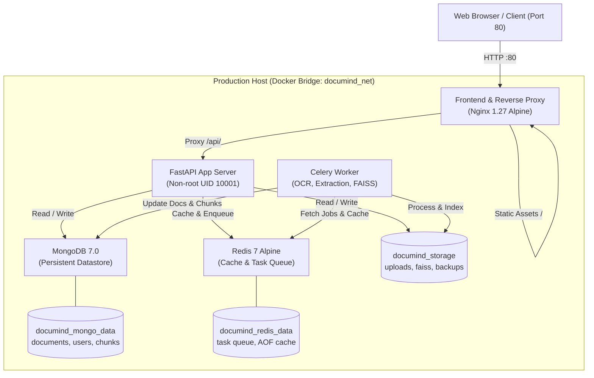

# DocuMind AI — Production Deployment & Acceptance Guide

This guide outlines the production deployment architecture, security configuration, persistent storage model, and end-to-end verification procedures for **DocuMind AI**.

---

## 1. Deployment Architecture & Environment Decision (Step 15.1)

DocuMind AI uses a **Docker Compose v2** single-node multi-container orchestration architecture.

### Why Docker Compose?
* **Deterministic Reproducibility:** Packages all five services (React SPA + Nginx, FastAPI, Celery worker, MongoDB 7.0, and Redis 7.0) with exact dependencies, volume mounts, and network isolation.
* **Single-Origin Simplicity:** Nginx acts as the unified reverse proxy, serving the compiled React frontend assets while proxying `/api` traffic internally to the FastAPI backend. This completely eliminates CORS issues in production and ensures datastores remain unexposed to the host or internet.
* **Cost & Operational Efficiency:** Avoids the maintenance overhead and cloud lock-in of Kubernetes or multi-cluster infrastructure while guaranteeing high reliability, healthcheck auto-restart, and strict resource boundaries.

### Production Topology Diagram



---

## 2. Production Configuration & Security (Step 15.2)

### 2.1 Service Specifications

| Service | Image / Base | Internal Port | External Port | Memory Limit | CPU Limit | Health Check |
| :--- | :--- | :--- | :--- | :--- | :--- | :--- |
| **frontend** | `nginx:1.27-alpine` | `80` | `80` (or `${PORT}`) | 256 MB | 1.0 CPU | `curl -f http://127.0.0.1/healthz` |
| **backend** | `python:3.12-slim` | `8000` | *None (internal only)* | 1536 MB | 2.0 CPU | `curl -f http://127.0.0.1:8000/health/ready` |
| **celery_worker** | `python:3.12-slim` | *None* | *None* | 1536 MB | 2.0 CPU | Task heartbeat via Redis |
| **mongodb** | `mongo:7.0` | `27017` | *None (internal only)* | 1024 MB | 1.5 CPU | `mongosh --eval "db.adminCommand('ping')"` |
| **redis** | `redis:7-alpine` | `6379` | *None (internal only)* | 384 MB | 1.0 CPU | `redis-cli ping` |

### 2.2 Security Hardening
* **Non-Root Execution:** The backend and worker run as unprivileged user `documind` (UID `10001`, GID `10001`).
* **Kernel Security Flags:** All services run with `security_opt: [no-new-privileges:true]`. Redis drops all Linux capabilities (`cap_drop: [ALL]`).
* **Network Isolation:** Only the frontend container binds to the host interface. MongoDB and Redis communicate exclusively over the internal Docker network `documind_net`.
* **Zero Secrets in Git:** Sensitive environment variables (`JWT_SECRET_KEY`, `GEMINI_API_KEY`) are managed via `.env` files that are strictly `.gitignore`d. Docker build contexts use `.dockerignore` to prevent local virtualenvs or credential files from entering image layers.

### 2.3 Persistent Volumes

Three persistent Docker named volumes maintain state across container restarts and image updates:
1. `documind_storage`: Uploaded receipt files (`storage/uploads`), FAISS vector index files (`storage/faiss`), and index snapshots.
2. `documind_mongo_data`: MongoDB primary data files for user accounts, document metadata, OCR extracts, and chunk mappings.
3. `documind_redis_data`: Append-only file (`appendonly yes`) persistence for active task queue and semantic cache state.

---

## 3. Step-by-Step Deployment Instructions

### Step 1: Clone Repository & Switch to Deploy Branch
```bash
git clone https://github.com/Swapnaja14/DocuMindAI--AI-Powered-Receipt-Document-Intelligence-System.git
cd DocuMindAI--AI-Powered-Receipt-Document-Intelligence-System
git checkout deploy
```

### Step 2: Configure Environment Variables
Copy the production environment template:
```bash
cp .env.production.example .env
```

Generate a secure 256-bit secret key for JWT signing:
```bash
openssl rand -hex 32
```
Open `.env` and set:
* `JWT_SECRET_KEY`: Insert the generated 256-bit key.
* `GEMINI_API_KEY`: Insert your active Google Gemini API key.
* `PORT`: Set your desired external port (default: `80`).

### Step 3: Build & Start the Production Stack
```bash
docker compose up -d --build
```

### Step 4: Verify Container Health & Status
```bash
docker compose ps
```
All containers (`documind-frontend`, `documind-backend`, `documind-worker`, `documind-mongodb`, `documind-redis`) should display state **Up (healthy)**.

---

## 4. Observability & Health Probes

DocuMind AI provides three tiered health probe endpoints accessible via the backend or reverse proxy:

### 1. Liveness Probe (`GET /api/v1/health/live`)
* Confirms the FastAPI event loop is responsive.
* Returns `200 OK` with `{"status": "alive"}`.

### 2. Readiness Probe (`GET /api/v1/health/ready`)
* Validates connectivity to core datastores (MongoDB & Redis).
* Returns `200 OK` when ready to serve traffic, `503 Service Unavailable` during database partition.

### 3. Comprehensive Operational Diagnostics (`GET /api/v1/health`)
* Aggregates live subsystem telemetry:
  * MongoDB connection and ping latency.
  * Redis availability and memory usage.
  * FAISS vector index count and integrity status.
  * Celery worker availability and active backlog.
  * Google Gemini API configuration status.

To inspect logs in real time:
```bash
# View backend API requests
docker compose logs -f backend

# View OCR and vector indexing tasks
docker compose logs -f celery_worker

# View Nginx access and error logs
docker compose logs -f frontend
```

---

## 5. Maintenance, Recovery & Auditing

### 5.1 Run Automated Security Audit Inside Container
```bash
docker compose exec backend python scripts/audit_security.py
```

### 5.2 Validate FAISS Vector Consistency
```bash
docker compose exec backend python scripts/check_consistency.py
```

### 5.3 Trigger Manual Vector Re-indexing
```bash
docker compose exec backend python scripts/reindex_all_documents.py
```

### 5.4 Graceful Shutdown & Updates
```bash
# Stop containers safely (preserves volumes)
docker compose down

# Pull latest updates and rebuild
git pull origin main
docker compose up -d --build
```
