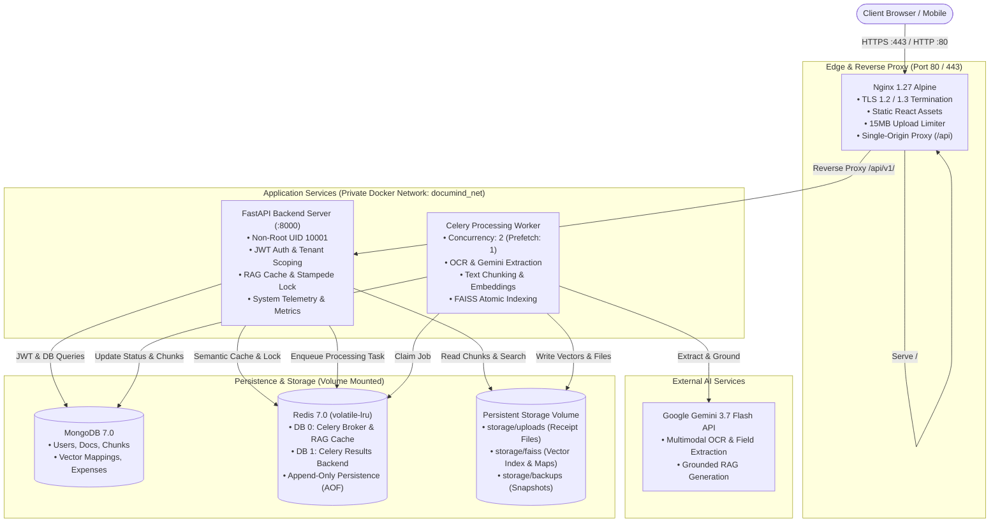

# DocuMind AI — AI-Powered Receipt & Document Intelligence System

[](https://www.python.org/)
[](https://fastapi.tiangolo.com/)
[](https://react.dev/)
[](https://www.docker.com/)
[](LICENSE)

**DocuMind AI** is an enterprise-grade document intelligence system designed for automated receipt and invoice processing. It pairs **multimodal OCR & AI extraction** (Google Gemini) with a **Retrieval-Augmented Generation (RAG)** pipeline and **FAISS vector search**, providing grounded question-answering, real-time expense analytics, and distributed asynchronous background processing.

---

## Table of Contents
1. [Project Architecture](#1-project-architecture)
2. [Prerequisites](#2-prerequisites)
3. [Local Development Setup](#3-local-development-setup)
4. [Environment Variables Reference](#4-environment-variables-reference)
5. [Docker & Containerized Deployment](#5-docker--containerized-deployment)
6. [Database & Index Initialization](#6-database--index-initialization)
7. [Testing & Acceptance Suites](#7-testing--acceptance-suites)
8. [API Documentation](#8-api-documentation)
9. [Production Deployment & Security](#9-production-deployment--security)
10. [Troubleshooting & Gotchas](#10-troubleshooting--gotchas)
11. [Disaster Recovery & Backup](#11-disaster-recovery--backup)

---

## 1. Project Architecture

DocuMind AI is organized as a decoupled, microservices-style single-node multi-container architecture orchestrated by Docker Compose.



### Core Architecture Components
1. **Frontend SPA (`frontend/`):** React 19, Vite, React Router 7, and Lucide Icons. Compiled to static HTML/CSS/JS and served through Nginx.
2. **Backend API (`backend/`):** FastAPI asynchronous ASGI server managing authentication, document quotas, search queries, RAG pipeline, and health monitoring.
3. **Task Queue (`backend/app/tasks/`):** Celery background workers handle CPU-intensive and I/O-bound tasks: document OCR, LLM extraction validation, chunking, and embedding generation.
4. **Primary Datastore (MongoDB 7.0):** Stores user credentials, document metadata, processing status, extracted financial fields, and chunk text.
5. **Cache & Broker (Redis 7.0):** Acts as the Celery message broker, task result backend, and multi-tenant RAG cache with generation-based invalidation. Configured with `--maxmemory-policy volatile-lru` to protect permanent Celery queues.
6. **Vector Search (FAISS):** Local high-performance Facebook AI Similarity Search Index with atomic write/replace mechanisms and automatic disaster recovery from MongoDB mappings.

---

## 2. Prerequisites

### Bare-Metal Local Development
* **Python:** Version `3.11` or `3.12`
* **Node.js:** Version `18.x` or `20.x` with `npm`
* **MongoDB:** Version `6.0` or `7.0` running locally on port `27017`
* **Redis:** Version `6.2` or `7.0+` running locally on port `6379`
* **Tesseract OCR (Optional):** If testing bare-metal local OCR fallback without Gemini.
* **Poppler (Optional):** Required on Windows for `pdf2image` if PyMuPDF fallback is bypassed.

### Containerized Deployment (Recommended)
* **Docker:** Version `24.0+`
* **Docker Compose:** Version `v2.20+`
* **Google Gemini API Key:** Obtain an API key from [Google AI Studio](https://aistudio.google.com/app/apikey).

---

## 3. Local Development Setup

### 3.1 Clone Repository
```bash
git clone https://github.com/Swapnaja14/DocuMindAI--AI-Powered-Receipt-Document-Intelligence-System.git
cd DocuMindAI--AI-Powered-Receipt-Document-Intelligence-System
```

### 3.2 Backend Setup
1. Navigate to the `backend` directory:
   ```bash
   cd backend
   ```
2. Create and activate a Python virtual environment:
   ```bash
   # Windows (PowerShell)
   python -m venv venv
   .\venv\Scripts\Activate.ps1

   # Linux / macOS
   python3 -m venv venv
   source venv/bin/activate
   ```
3. Install dependencies:
   ```bash
   pip install --upgrade pip
   pip install -r requirements.txt
   ```
4. Configure environment variables:
   ```bash
   cp .env.example .env
   # Edit .env and set your GEMINI_API_KEY and a random JWT_SECRET_KEY
   ```
5. Launch the backend development server using the resilient launcher:
   ```bash
   python run_dev.py
   # Or directly with Uvicorn:
   # uvicorn app.main:app --host 127.0.0.1 --port 8000 --reload
   ```
   *The backend will be live at `http://127.0.0.1:8000`.*

6. Start Celery worker in a separate terminal:
   ```bash
   # Windows (Solo execution pool recommended for Windows OS)
   celery -A app.celery_app worker --loglevel=INFO -P solo

   # Linux / macOS
   celery -A app.celery_app worker --loglevel=INFO --concurrency=2
   ```

### 3.3 Frontend Setup
1. In a separate terminal, navigate to `frontend`:
   ```bash
   cd frontend
   ```
2. Install npm dependencies:
   ```bash
   npm install
   ```
3. Start Vite development server:
   ```bash
   npm run dev
   ```
   *The frontend will be live at `http://localhost:5173`.*

---

## 4. Environment Variables Reference

| Variable | Default Value | Description |
| :--- | :--- | :--- |
| `ENVIRONMENT` | `development` | Deployment environment (`development` or `production`). In production, interactive Swagger UI (`/docs`) is disabled. |
| `DEBUG` | `false` | Enables verbose debug logging and traceback outputs. |
| `PORT` | `80` | External HTTP port bound by Nginx reverse proxy. |
| `HTTPS_PORT` | `443` | External HTTPS port bound by Nginx reverse proxy. |
| `CORS_ORIGINS` | `http://localhost:5173` | Comma-separated list of permitted browser origins. |
| `MONGODB_URL` | `mongodb://localhost:27017` | MongoDB connection URI (`mongodb://mongodb:27017` in Docker). |
| `MONGODB_DATABASE` | `documind` | Target MongoDB database name. |
| `JWT_SECRET_KEY` | *(Must be generated)* | 256-bit cryptographically secure key used for signing JWTs (`openssl rand -hex 32`). |
| `JWT_ALGORITHM` | `HS256` | JWT HMAC signing algorithm. |
| `ACCESS_TOKEN_EXPIRE_MINUTES`| `60` | JWT bearer token lifespan in minutes. |
| `UPLOAD_DIR` | `storage/uploads` | Path to save original uploaded receipt PDFs and images. |
| `MAX_FILE_SIZE_MB` | `10` | Maximum allowable single-file upload size. |
| `MAX_USER_STORAGE_MB`| `50` | Maximum cumulative storage allowed per user account. |
| `MAX_USER_DOCUMENTS` | `100` | Maximum number of uploaded documents allowed per user account. |
| `REDIS_URL` | `redis://localhost:6379/0` | Redis URI for RAG semantic answer cache and lock synchronization. |
| `REDIS_CACHE_TTL_SECONDS` | `600` | Time-to-live for cached RAG answers (10 minutes). |
| `REDIS_ENABLED` | `true` | Master flag to toggle Redis caching (fails open if false). |
| `CELERY_BROKER_URL` | `redis://localhost:6379/0` | Celery task message broker URI. |
| `CELERY_RESULT_BACKEND`| `redis://localhost:6379/1`| Celery task state and result backend URI. |
| `FAISS_INDEX_PATH` | `storage/faiss/chunks.index` | File path for persistent FAISS vector index. |
| `FAISS_MAPPING_PATH` | `storage/faiss/chunk_mapping.json`| File path mapping integer FAISS IDs to MongoDB chunk IDs. |
| `GEMINI_API_KEY` | *(Required)* | Google Gemini API Key for OCR extraction and RAG answer synthesis. |
| `GEMINI_MODEL` | `gemini-3.7-flash` | Target Google Gemini model version. |

---

## 5. Docker & Containerized Deployment

DocuMind AI provides a production-ready multi-container Docker Compose configuration with HTTPS auto-fallback, strict resource limits, non-root users, and isolated internal networks.

### 5.1 Quick Start with Docker Compose
1. Ensure Docker Desktop or Docker Engine is running.
2. Create your production `.env` from template:
   ```bash
   cp .env.production.example .env
   ```
3. Edit `.env` and configure:
   - `JWT_SECRET_KEY` (run `openssl rand -hex 32` to generate)
   - `GEMINI_API_KEY` (your Google Gemini API key)
4. Start the application stack:
   ```bash
   docker compose up --build -d
   ```
5. Verify container health status:
   ```bash
   docker compose ps
   ```

### 5.2 Key Docker Commands
* **View Aggregated Logs:**
  ```bash
  docker compose logs -f
  ```
* **View Specific Service Logs:**
  ```bash
  docker compose logs -f backend
  docker compose logs -f celery_worker
  ```
* **Restart Workers:**
  ```bash
  docker compose restart celery_worker
  ```
* **Graceful Teardown:**
  ```bash
  docker compose down
  ```
* **Teardown with Volume Removal (Destructive Wipe):**
  ```bash
  docker compose down -v
  ```

---

## 6. Database & Index Initialization

DocuMind AI automatically enforces database schemas and indexes on application boot.

### 6.1 MongoDB Indexes
On FastAPI startup (`app/core/database.py`), the system creates:
* **`users` Collection:**
  * Unique index on `email` (prevents duplicate user registration).
* **`documents` Collection:**
  * Compound index on `[("user_id", 1), ("processing.uploaded_at", -1)]` (optimized for user document listing).
  * Index on `status` (monitors processing and failure queues).
* **`document_chunks` Collection:**
  * Compound unique index on `[("document_id", 1), ("chunk_id", 1)]`.
* **`vector_mappings` Collection:**
  * Compound unique index on `[("document_id", 1), ("chunk_id", 1)]`.
  * Unique index on `faiss_id` (ensures 1:1 bidirectional mapping between FAISS and MongoDB).

### 6.2 FAISS Vector Index Initialization
The FAISS index directory (`storage/faiss/`) is created automatically upon first run. The system initializes:
* `storage/faiss/chunks.index`: Normalized cosine inner-product FAISS index (`IndexFlatIP`).
* `storage/faiss/chunk_mapping.json`: Bidirectional JSON lookup between integer IDs and chunk identifiers.
* `storage/faiss/manifest.json`: Atomic metadata manifest recording vector counts and hash checksums.

---

## 7. Testing & Acceptance Suites

The repository contains comprehensive unit, integration, persistence, and production acceptance test suites using `pytest` and `vitest`.

### 7.1 Running Backend Pytest Suites
From the `backend/` directory with your virtual environment active:

1. **Complete Production Acceptance Suite (12 Lifecycle Steps):**
   ```bash
   pytest tests/test_production_acceptance_suite.py -v
   ```
   *Verifies user registration, login, PDF upload, OCR/extraction, chunk indexing, RAG grounded answer, cache hits, invalidation on new upload, document deletion, tenant isolation, and recoverable fault tolerance.*

2. **Deployment Monitoring & Persistence Suite:**
   ```bash
   pytest tests/test_deployment_monitoring_and_persistence.py -v
   ```
   *Verifies storage survivability, MongoDB persistence, FAISS rebuild capabilities, Redis memory tracking, and telemetry.*

3. **Backup and Recovery Disaster Recovery Suite:**
   ```bash
   pytest tests/test_backup_and_recovery.py -v
   ```

4. **FAISS Vector Consistency Suite:**
   ```bash
   pytest tests/test_faiss_consistency.py -v
   ```

5. **Run All Backend Tests:**
   ```bash
   pytest -v
   ```

### 7.2 Running Frontend Tests
From the `frontend/` directory:
```bash
npm run test
```

---

## 8. API Documentation

When running in `development` mode (`ENVIRONMENT=development`), interactive OpenAPI documentation is available at:
* Swagger UI: `http://localhost:8000/docs`
* ReDoc: `http://localhost:8000/redoc`

*(Note: Interactive documentation is automatically disabled in `production` to prevent schema leakage).*

### 8.1 Authentication Endpoints (`/api/v1/auth`)
* `POST /register`: Register a new user (`email`, `password`).
* `POST /login`: Authenticate and receive a JWT Bearer access token.
* `POST /logout`: Invalidate user session and clear active semantic caches.

### 8.2 Document Management (`/api/v1/documents`)
* `POST /upload`: Multipart form upload for PDF/PNG/JPEG receipts (max 10MB). Enqueues asynchronous Celery processing pipeline.
* `GET /`: List authenticated user's documents (supports pagination and status filtering).
* `GET /{doc_id}`: Retrieve detailed processing status, OCR extraction results, and chunk counts.
* `GET /{doc_id}/download`: Securely download original uploaded receipt file.
* `DELETE /{doc_id}`: Permanently delete document, associated text chunks, FAISS vector embeddings, and invalidate user RAG cache.

### 8.3 Expense Intelligence (`/api/v1/expenses`)
* `GET /summary`: Aggregated financial metrics (total spend, average receipt value, merchant count, top spending categories).
* `GET /transactions`: Line-item breakdown of validated receipt purchases.
* `GET /trends`: Monthly and temporal spending analytics.

### 8.4 Semantic Search (`/api/v1/search`)
* `POST /semantic`: Vector similarity search across document chunks with tenant scoping.
* `POST /filter`: Structured metadata filtering (merchant, date range, amount range).

### 8.5 Retrieval-Augmented Generation (`/api/v1/rag`)
* `POST /ask`: Ask natural language questions grounded in authenticated receipt documents. Returns answers, citations (`sources`), and retrieval metadata. Supports generation-based Redis caching and distributed stampede locks.

### 8.6 System Health & Telemetry (`/api/v1/health`)
* `GET /`: Overall system health and datastore connectivity status.
* `GET /ready`: Kubernetes/Docker readiness probe for load balancers.
* `GET /alerts`: Active system alerts (disk capacity, queue depth, datastore health).
* `GET /metrics`: Thread-safe latency percentiles and error metrics.

---

## 9. Production Deployment & Security

### 9.1 HTTPS & TLS Configuration
* **Automated Self-Signed Fallback:** The Nginx container entrypoint (`frontend/docker-entrypoint.sh`) checks for `./ssl/cert.pem` and `./ssl/key.pem`. If absent, it automatically provisions a 2048-bit RSA self-signed certificate, enabling immediate testing over `https://localhost`.
* **Custom Certificates:** To install official CA or Let's Encrypt certificates, place `cert.pem` (full chain) and `key.pem` (private key) in the root `./ssl/` folder and restart the container.
* **HTTP to HTTPS Redirection:** Port 80 issues a permanent HTTP 301 redirect to port 443 with HSTS enabled (`Strict-Transport-Security: max-age=31536000; includeSubDomains`).

### 9.2 Private Datastore Isolation
MongoDB (`27017`), Redis (`6379`), and FastAPI (`8000`) do not expose ports to the host machine. All inter-service traffic travels through the isolated Docker bridge network `documind_net`. Only Nginx exposes ports `80` and `443`.

### 9.3 Security Hardening Summary
* **Non-Root Execution:** FastAPI and Celery containers execute under user `documind` (UID `10001`, GID `10001`).
* **Kernel Flags:** All containers enforce `no-new-privileges: true`. Redis drops all kernel capabilities (`cap_drop: [ALL]`).
* **Safe Eviction (`volatile-lru`):** Protects Celery task queues from being dropped when Redis operates under memory pressure.

---

## 10. Troubleshooting & Gotchas

### 10.1 Windows Socket / Port 8000 Conflicts
* **Symptom:** `[WinError 10048] Only one usage of each socket address is normally permitted`.
* **Solution:** A background zombie process or previous Uvicorn instance is holding port 8000. Run:
  ```bash
  python backend/run_dev.py
  ```
  *The script automatically queries netstat, locates the orphan PID, terminates it gracefully, and binds cleanly.*

### 10.2 Celery Connection Delays on Boot
* **Symptom:** Celery worker logs `consumer: Cannot connect to redis://...: Error 111 connecting to redis`.
* **Solution:** Celery is configured with `broker_connection_retry_on_startup=True` and exponential backoff (`interval_start=1.0`, `interval_max=10.0`). It will automatically attach once the Redis container passes health checks.

### 10.3 Redis Caching in Test Environments
* **Symptom:** `ConnectionRefusedError: [WinError 1225]` during offline unit tests.
* **Solution:** DocuMind AI implements fail-open semantics (`app/services/cache_service.py`). When Redis is unreachable, the system automatically falls back to direct database retrieval without crashing. In test suites, use `test_production_acceptance_suite.py` which provides high-fidelity in-memory caching mocks.

---

## 11. Disaster Recovery & Backup

DocuMind AI includes an automated, DB-driven disaster recovery utility (`backend/scripts/backup_and_recovery.py`).

### 11.1 Create Full System Backup
Captures MongoDB state, disk files, and active vector mappings:
```bash
python backend/scripts/backup_and_recovery.py --backup
```
*Creates a timestamped snapshot in `storage/backups/documind_backup_<timestamp>.tar.gz`.*

### 11.2 Restore System from Backup Archive
```bash
python backend/scripts/backup_and_recovery.py --restore storage/backups/documind_backup_<timestamp>.tar.gz
```

### 11.3 Automated FAISS Rebuild from Database
If FAISS index files (`chunks.index` or `chunk_mapping.json`) become corrupted or desynchronized:
```bash
python backend/scripts/backup_and_recovery.py --rebuild-faiss
```
*Scans MongoDB's `document_chunks` and `vector_mappings` collections, regenerates missing embeddings, and publishes a validated, structurally sound FAISS index atomically without service downtime.*

---

## License

This project is licensed under the MIT License. See [LICENSE](LICENSE) for details.